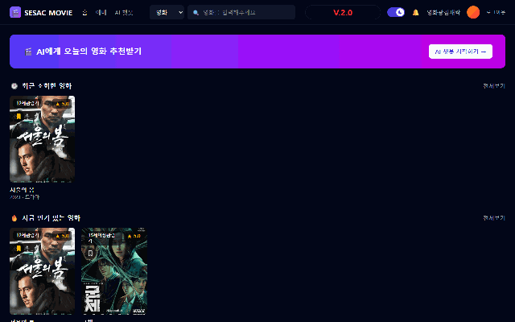
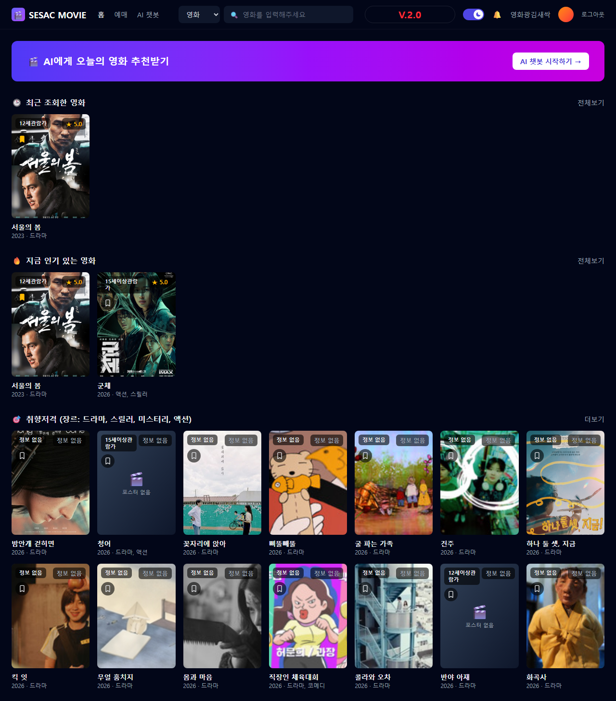
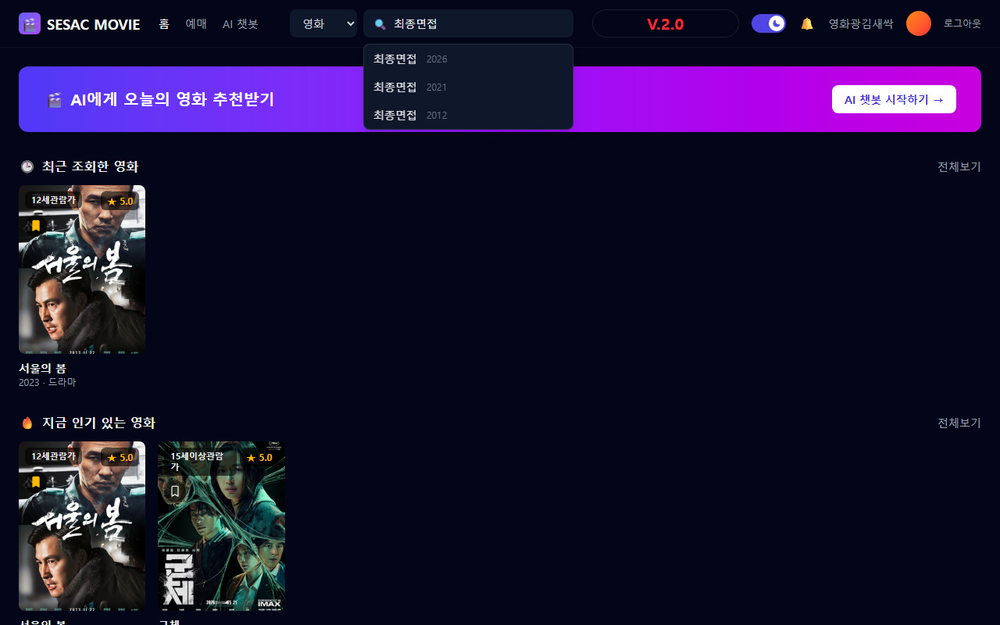
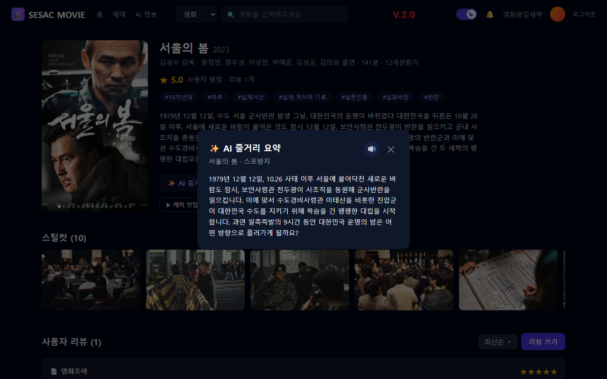
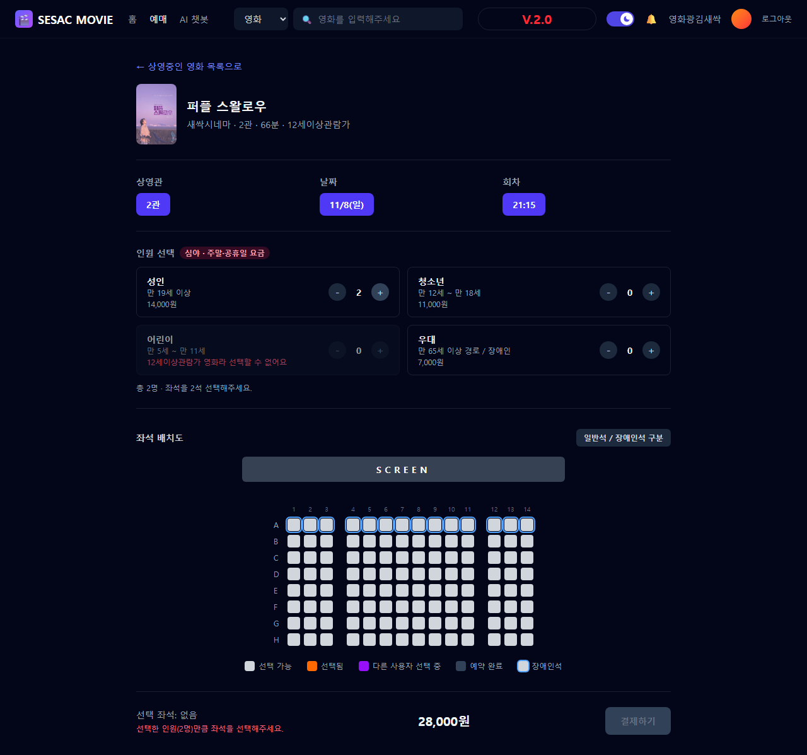
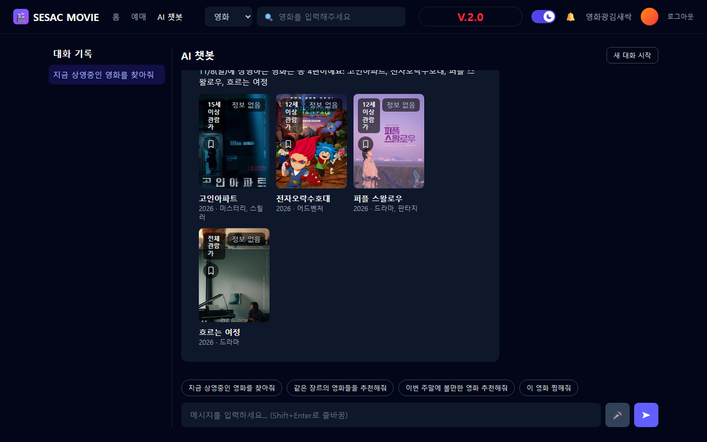
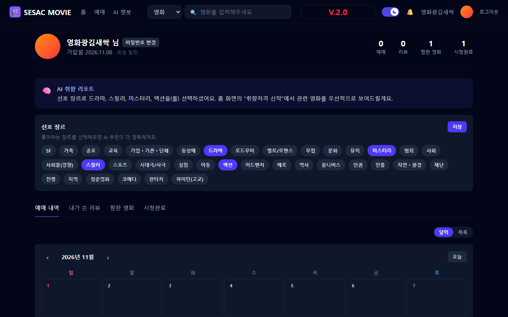
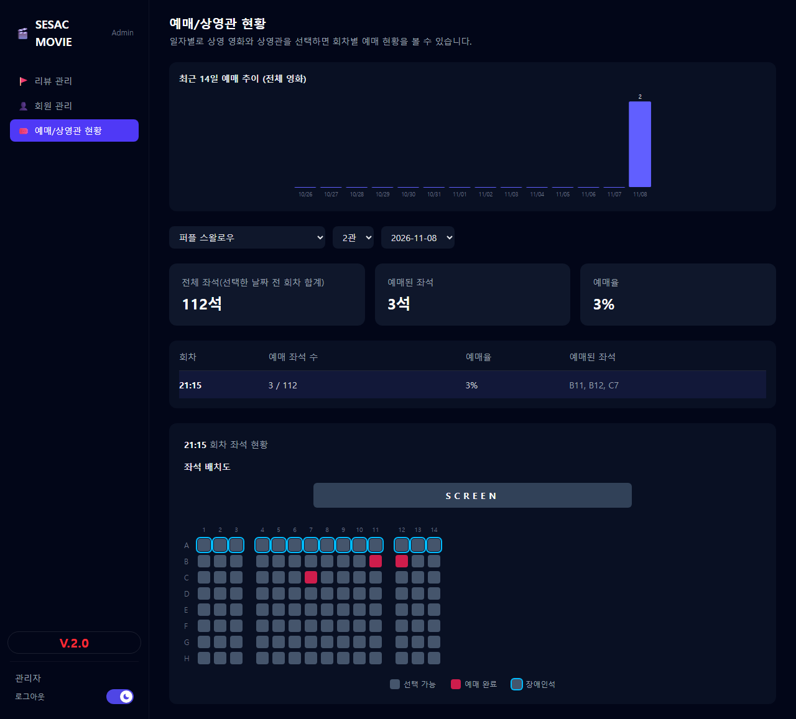

# 🎬 SESAC MOVIE

KMDB(한국영화데이터베이스) Open API 기반의 영화 예매 서비스입니다. 영화 탐색부터 좌석 예매·결제, AI 챗봇을 통한 대화형 예매, 리뷰·찜 목록까지 실제 영화관 예매 서비스에 준하는 기능을 구현했습니다.

[](https://www.oracle.com/java/)
[](https://spring.io/projects/spring-boot)
[](https://react.dev/)
[](https://vite.dev/)
[](https://www.mysql.com/)

## 🎥 데모



홈 → 영화 상세(AI 요약) → 좌석 예매 → AI 챗봇 → 마이페이지 → 관리자 화면 순으로 핵심 흐름을 빠르게 둘러볼 수 있습니다. 각 화면의 상세 스크린샷은 [아래 스크린샷 섹션](#스크린샷)에 있습니다.

## ✨ 주요 기능

### 일반 사용자
- **영화 탐색**: 장르·개봉연도·러닝타임·연령등급 다중 필터, 최신순/이름순/평점순 정렬
- **헤더 검색 자동완성**: 영화 제목/배우/감독 기준 실시간 자동완성(최대 5개), 동명 영화는 개봉연도 최신순으로 표시
- **영화 상세**: AI 줄거리 요약(스포일러 방지, 음성으로 읽어주기 지원), 스틸컷 갤러리, 사용자 리뷰 작성/수정/삭제 및 정렬(최신순/평점순)
- **마이페이지**: 예매 내역(캘린더/목록), 찜한 영화(지금 상영중 배지·필터), 시청완료, 내가 쓴 리뷰, 선호 장르 설정
- **홈 화면**: 최근 조회한 영화(전체보기 지원), 지금 인기 있는 영화, 선호 장르 기반 맞춤 추천

### 예매
- 실시간 좌석 배치도(선점/예약 상태 반영), 인원 구분별 요금 자동 계산(주중/주말/공휴일·시간대 차등)
- 좌석 임시 선점(hold) 및 TTL 자동 만료, 결제 중 좌석 충돌 방지, 1회 예매 최대 10명 제한
- 토스페이먼츠 결제위젯 연동, 예매 완료/취소/임박 알림

### AI 챗봇
- Gemini 기반 자연어 대화로 영화 추천, 상영정보·좌석현황 조회, 예매·예매취소·좌석변경까지 전부 대화로 처리
- 조건(장르/연도/키워드) 기반 추천, 대화 맥락 유지("그거 예매해줘" 같은 지시 표현 처리)
- 음성 입력(STT)으로 말로 질문/예매, 대화방(세션) 관리 — 생성/목록/삭제

### 관리자
- 리뷰 관리(전체 리뷰 조회·삭제), 회원 관리(활동 집계 포함)
- 상영관별 예매 현황판(좌석 배치도), 기간별 예매 추이 그래프

## 📸 스크린샷

<table>
<tr>
<td width="50%">

**홈 — 최근 조회 · 인기 · 맞춤 추천**


</td>
<td width="50%">

**헤더 검색 자동완성 (동명 영화는 최신연도순)**


</td>
</tr>
<tr>
<td width="50%">

**영화 상세 — AI 줄거리 요약(읽어주기) · 스틸컷 · 리뷰**


</td>
<td width="50%">

**좌석 선택 — 실시간 좌석 배치도 · 인원별 요금**


</td>
</tr>
<tr>
<td width="50%">

**AI 챗봇 — 대화로 영화 추천/예매**


</td>
<td width="50%">

**마이페이지 — 예매 내역 · 찜 · 선호 장르**


</td>
</tr>
</table>

**관리자 — 상영관별 좌석 현황 · 예매 추이 그래프**


## 🛠 기술 스택

| 영역 | 스택 |
| --- | --- |
| 백엔드 | Java 17, Spring Boot 3.5(Web/Validation/Data JPA), MySQL 8, Gradle |
| 프론트엔드 | React 19, React Router 7, Vite 8, Tailwind CSS 4 |
| 외부 연동 | KMDB Open API, Gemini API(AI 요약·챗봇), 토스페이먼츠 결제위젯 |
| 인증 | 비밀번호 해시(BCrypt) + `X-User-Id` 헤더 기반 데모 인증 |

## 📁 프로젝트 구조

```
.
├── backend/    # Spring Boot REST API — 상세는 backend/README.md 참고
├── frontend/   # React + Vite SPA — 상세는 frontend/README.md 참고
└── db/         # schema.sql, docker-compose.yml(로컬 MySQL)
```

각 영역의 패키지/폴더 구조와 설계 포인트는 [backend/README.md](backend/README.md), [frontend/README.md](frontend/README.md)에 자세히 정리해뒀습니다.

## 🚀 시작하기

### 사전 요구사항
- JDK 17
- Node.js 20 이상
- MySQL 8 (Docker 또는 로컬 설치)
- [KMDB ServiceKey](https://www.kmdb.or.kr/info/api/apiDetail/6), [Gemini API 키](https://aistudio.google.com/apikey) (둘 다 무료 발급)

### 1. 데이터베이스 준비

**Docker 사용 시** (가장 간편):
```bash
cd db
docker compose up -d   # schema.sql이 최초 1회 자동 적용됩니다
```

**로컬 MySQL 사용 시**: `db/schema.sql`을 직접 실행해 테이블을 생성하세요.

### 2. 백엔드 API 키 설정

`backend/src/main/resources/application-local.yml` 파일을 만들고(또는 수정하고) 발급받은 키를 입력합니다. 이 파일은 `.gitignore`에 등록되어 있어 커밋되지 않습니다. `backend/src/main/resources/application-local.example.yml`을 복사해서 시작하면 편합니다.

```yaml
kmdb:
  service-key: 발급받은_KMDB_SERVICE_KEY

gemini:
  api-key: 발급받은_GEMINI_API_KEY
```

### 3. 백엔드 실행

```bash
cd backend
./gradlew bootRun       # Windows: gradlew.bat bootRun
```

기본 포트는 `8080`입니다. 첫 실행 시 KMDB 전체 카탈로그를 백그라운드로 스캔해 캐싱하므로, 일부 필터 조합은 초기 몇 분간 정확한 건수가 아닌 추정치로 보일 수 있습니다(자동으로 보정됩니다).

### 4. 프론트엔드 실행

```bash
cd frontend
npm install
npm run dev
```

기본적으로 `http://localhost:5173`에서 접속할 수 있고, `http://localhost:8080` API 서버를 바라봅니다(`frontend/.env`의 `VITE_API_BASE_URL`로 변경 가능).

### 5. 로그인

`db/schema.sql`에 기본 관리자 계정이 하나 포함되어 있습니다(보안상 계정 정보는 README에 적지 않습니다). 관리자로 로그인하려면 회원가입 후 DB에서 본인 계정의 `is_admin`을 `TRUE`로 바꾸거나, `db/schema.sql`의 관리자 계정 INSERT 구문을 원하는 아이디/비밀번호로 직접 수정해 적용하세요.

일반 사용자는 회원가입 화면에서 직접 가입해 이용할 수 있습니다.

---

## 🔑 참고 사항

- 결제는 토스페이먼츠가 공식 문서에서 공개한 **테스트 전용 키**로 연동되어 있어 실제 결제가 발생하지 않습니다.
- 인증은 정식 토큰(JWT 등) 대신 로그인한 사용자의 `id`를 `X-User-Id` 헤더로 전달하는 데모 수준으로 구현되어 있습니다.
- KMDB Open API 응답을 서버에서 캐싱·재가공하여 "전체 영화 N건" 같은 집계가 실제 목록과 항상 정확히 일치하도록 처리했습니다.
- AI 줄거리 요약 읽어주기(TTS)와 챗봇 음성 입력(STT)은 브라우저 내장 Web Speech API를 사용해 별도 서버 비용 없이 동작하며, 지원하지 않는 브라우저에서는 해당 버튼이 자동으로 숨겨집니다.
